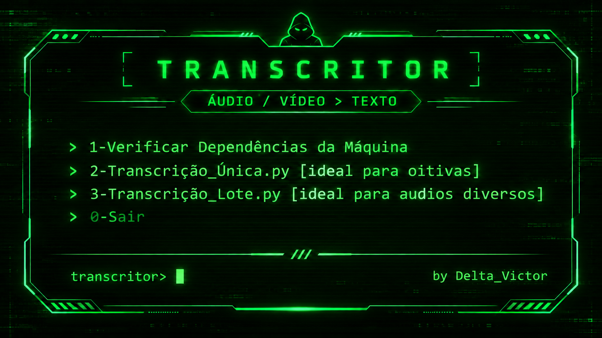

# Transcritor — by Delta_Victor

Transcrição local de áudio e vídeo em português brasileiro com Whisper large-v3-turbo, saída TXT e DOCX e opções para transcrição única ou em lote.

## Instalação e uso

1. [Baixe o pacote mínimo Transcritor_Final.zip](https://github.com/Delta369369/transcritorMT/raw/refs/heads/main/Transcritor_Final.zip) e extraia todo o conteúdo para uma pasta com permissão de escrita.
2. Dentro da pasta **Transcritor**, abra **Abrir_Transcritor_Admin.bat** para acessar o PowerShell 7. Na primeira utilização, escolha **1 — Verificar Dependências da Máquina**.

Requer Windows, PowerShell 7 e um Python instalado para iniciar a preparação. O auxiliar prepara Python 3.12 de 64 bits em um ambiente virtual local, instala as dependências necessárias e baixa o modelo quando ele ainda não está disponível. A primeira preparação requer internet; as próximas utilizações reaproveitam os componentes instalados. GPU NVIDIA é opcional, com alternativa por CPU.

## Opções do menu

- **1 — Verificar Dependências da Máquina:** prepara e testa o ambiente.
- **2 — Transcrição Única:** relatórios individuais com tempos, ideal para oitivas.
- **3 — Transcrição em Lote:** relatórios consolidados para áudios diversos.
- **0 — Sair.**

Consulte o [manual de instalação e uso](Apoio/README.md).

Os relatórios são gerados automaticamente e devem ser conferidos com a mídia original, especialmente nomes, números e termos técnicos.

## Identidade visual e distribuição

A arte completa é o banner do projeto. O menu do PowerShell usa uma adaptação em texto com fundo preto, moldura verde e a assinatura **by Delta_Victor**, sem bibliotecas gráficas adicionais.

O ZIP de distribuição contém apenas os seis arquivos necessários ao funcionamento. A arte permanece separada para manter o pacote mínimo.
